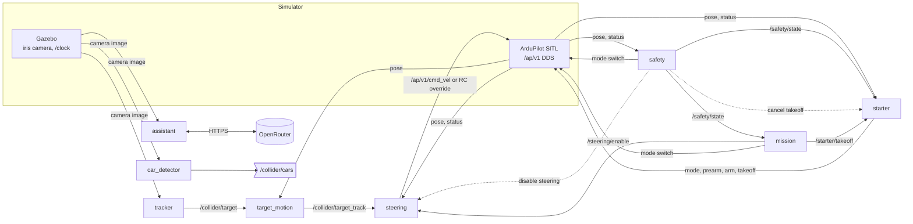

# Architecture

Collider flies an ArduPilot Copter in Gazebo toward a target seen by the drone's forward
camera. Each function runs as its own ROS 2 node in the `collider` package; custom messages
and actions live in `collider_interfaces`. The nodes talk to ArduPilot through its DDS
interface (`/ap/v1/...`). The RC steering backend is the one exception and uses MAVLink.

Starting the nodes sends nothing to the vehicle. The Starter and the mission wait for action
goals, steering starts disabled, and the safety supervisor acts only on a violation or a
manual request.

## Overview

In the diagram, pose is `/ap/v1/pose/filtered` and status is `/ap/v1/status`. The camera
topic is `/iris/static_camera_sensor/image`. With `use_sim_time`, every node also follows
Gazebo's `/clock` (see [Simulation time](#simulation-time)).

## Target pipeline

The pursuit loop is three nodes, each with one job.

1. `tracker` finds the target in every camera frame and publishes a `TargetObservation`:
   whether the target is visible, its bounding box, and its angles from the image centre.
2. `target_motion` pairs each observation with the vehicle attitude at the image timestamp,
   converts the camera angles into a world bearing and elevation, and filters them into a
   `TargetTrack` with rates of change.
3. `steering` flies forward at a fixed cruise speed, turns toward the predicted bearing,
   climbs or descends toward the target's elevation, and sends the result to ArduPilot
   through one of two backends.

Perception and estimation never command the vehicle. Only `steering`, `starter`, `safety`
and `mission` send commands to ArduPilot.

## Flight management

`starter` serves the `Takeoff` action. It switches to GUIDED, waits for the prearm check,
arms, requests takeoff and confirms the climb from telemetry. Cancelling or failing a goal
runs a cleanup that lands and disarms when motors were already commanded.

`mission` serves the `Mission` action and orchestrates a whole flight: takeoff through the
Starter, steering for a set time, then LAND, RTL or hover. It coordinates other nodes and
does no flying of its own.

`safety` watches telemetry and ArduPilot failsafes. On a violation or a manual request it
switches ArduPilot to BRAKE (then optionally LAND or RTL), disables steering and cancels
takeoff goals. Its state is published on `/safety/state`; the Starter and the mission
refuse to start while it is not `OK`.

## Auxiliary nodes

`car_detector` runs a YOLO model on every frame and publishes all vehicles it finds on
`/collider/cars`. No node in the package consumes it.

`assistant` answers free-form questions about the newest camera frame through a vision
language model on OpenRouter, exposed as the `/collider/ask` action.

## Interfaces

Messages (`collider_interfaces/msg`):

| Type | Published on | Content |
| --- | --- | --- |
| `TargetObservation` | `/collider/target` | Per frame: `tracking`, camera angles, bbox, image size |
| `TargetTrack` | `/collider/target_track` | Per frame: `valid`, `measured`, world bearing/elevation and their rates |
| `CarDetections` | `/collider/cars` | Per frame: image size and a `CarDetection[]` array (possibly empty) |

Actions (`collider_interfaces/action`):

| Type | Server | Purpose |
| --- | --- | --- |
| `Takeoff` | `/starter/takeoff` | Arm and climb to `altitude_m` above home |
| `Mission` | `/mission/run` | Takeoff, steer for `duration_sec`, then `end_action` |
| `Ask` | `/collider/ask` | Question about the current camera image |

`PrepareDrone` is defined in the interface package but not served by any node.

## Conventions

- Body frame is FLU (x forward, y left, z up), world frame is ENU (x east, y north, z up),
  as in REP 103. ArduPilot's pose orientation rotates body to world.
- Camera angles (`azimuth_deg`, `elevation_deg` in `TargetObservation` and `CarDetection`)
  are measured from the image centre with the pinhole model `atan(pixels / focal_px)`.
  Positive azimuth is right of centre, positive elevation is above centre.
- World angles in `TargetTrack`: `bearing_deg` is a compass bearing (0 north, 90 east,
  clockwise), `elevation_deg` is measured from the horizon. Positive bearing rate is
  clockwise.
- The camera is fixed to the body and looks forward: 640x480 pixels, 2 rad horizontal
  field of view, 20 Hz. Its focal length is `320 / tan(1) = 205.47` px, which equals `fx`
  in `camera_info` and the `focal_px` default.
- Output messages copy the camera image header, so `header.stamp` is the image's
  simulation time.
- Copter mode numbers used in code: GUIDED 4, LOITER 5, RTL 6, LAND 9, BRAKE 17.

## Design decisions

### Topics, actions and services

Perception publishes topics. Every frame produces exactly one message, including when
nothing was found (`tracking: false`, an empty `cars` array). A subscriber can therefore
tell an empty scene from a stopped publisher. There is nothing to request or cancel, so a
stream fits.

Operations that take seconds to minutes, report progress and must be cancellable are
actions: takeoff, mission, and assistant questions (a model answers in 2 to 20 s). Each
server runs one goal at a time and rejects a second one. The mission is both an action server and a client of the
Starter's action, and it forwards cancellation so the Starter can run its own cleanup.

The Starter rejects malformed goals but accepts a valid goal while safety is tripped and
aborts it immediately. A rejection carries no reason; a result does.

Instant switches are services: `/steering/enable` (`std_srvs/SetBool`) and the safety
buttons (`std_srvs/Trigger`).

No callback blocks on a service or action. Clients use `call_async` and either poll the
future from a timer (Starter, safety) or `await` it (mission). The assistant's blocking
HTTP call runs on a separate thread pool.

Two control styles are used on purpose. The Starter is an explicit state machine driven by
a 10 Hz timer, because its cleanup depends on exactly which commands were sent and
acknowledged. The mission is a single `async` function that reads top to bottom; waits are
futures completed by a 20 Hz timer, and any failure raises `MissionStopped`, which is
handled in one place.

### QoS

| Endpoint | Profile | Reason |
| --- | --- | --- |
| Camera image subscriptions | best effort, keep last 1 | Only the newest frame matters; a slow consumer skips frames instead of queueing |
| Observation, track and detection publishers | reliable, depth 10 | Small messages; a reliable publisher serves both reliable and best-effort subscribers |
| Debug image publishers | reliable, keep last 1 | `web_video_server` subscribes reliable; published only while someone subscribes |
| ArduPilot pose and status subscriptions | sensor data (best effort, volatile) | Matches either publisher reliability; freshness is checked by age instead |
| `/safety/state` | reliable, transient local, depth 1 | Latched: a node that starts later still receives the current state |

A best-effort publisher cannot serve a reliable subscriber, which is why every Collider
publisher is reliable even where loss would be acceptable.

### Simulation time

All nodes run with `use_sim_time` (the launch default) and take every timestamp, timeout and
timer period from the node clock through `node_time.now_sec()`. Pausing Gazebo pauses all
timeouts, so a paused simulation does not trip safety or abort a takeoff. A simulation
running faster than real time keeps command rates and durations correct in simulated
seconds.

Consequences handled in code:

- `node_time.age()` returns infinity for a negative age. After a simulator restart the clock
  starts again near zero, and data from the previous run must not look fresh.
- The Starter orders status messages by a receive counter rather than by timestamp. The
  simulation clock advances in discrete steps, so two events can share a timestamp.
- While simulation time is stalled, telemetry loss cannot be detected. The safety node
  keeps one timer on the steady clock and logs a warning when simulation time has not
  advanced for `clock_stall_warning_sec` while the vehicle is armed. It warns and never
  trips, because pausing is deliberate.
- The assistant measures HTTP latency and timeouts on the wall clock, since the network
  runs in real time regardless of the simulation.

### Steering backends (Strategy)

The centring controller produces a `DesiredMotion` in physical units: forward, left and up
in m/s, and yaw rate in deg/s (positive clockwise, matching bearings). A `SteeringBackend`
delivers it and exposes three methods: `required_mode()`, `send(motion, heading)` and
`stop()`. The controller does not know which backend runs, and a backend does not know why
it moves.

| | `CmdVelBackend` | `RcBackend` |
| --- | --- | --- |
| Link | DDS, `/ap/v1/cmd_vel` (`TwistStamped`) | MAVLink `RC_CHANNELS_OVERRIDE` |
| Flight mode | GUIDED | LOITER |
| Units | m/s and rad/s, exact | Stick PWM, scaled by ArduPilot |
| `stop()` | Zero velocity | All sticks centred |
| If the node dies | ArduPilot stops after `GUID_TIMEOUT` | Override expires after `RC_OVERRIDE_TIME` |

`CmdVelBackend` publishes in the `map` frame and rotates forward/left by heading only. In
`base_link` ArduPilot would apply the full attitude, so a tilted drone would turn part of a
horizontal command into vertical motion.

`RcBackend` maps each axis linearly between ArduPilot's stick dead zone and full deflection
using `StickScale`, which holds Copter's LOITER defaults (`PILOT_Y_RATE` 202.5 deg/s,
`PILOT_SPD_UP` 2.5 m/s, `LOIT_SPEED_MS` 12.5 m/s, dead zones 20/100/20 µs). Channels 5 to 8
are sent as 65535 (left untouched). Its `stop()` centres the sticks rather than releasing
them: in SITL the simulated radio's throttle may sit low, and LOITER would then descend.
Sending happens only from the node's timer, and only while steering is enabled in LOITER.

Tying each backend to one flight mode also defines the authority boundary that the safety
supervisor relies on: leaving GUIDED or LOITER makes every steering command ineffective.

### Tracker interface (Adapter)

`TrackerNode` depends only on the `Tracker` interface: `track(frame)` returns a bounding box
or `None`, `name()` labels the debug image, and `reset()` forgets the previous target.

`BlackSpotTracker` is the default. It thresholds the grayscale frame for near-black pixels,
searches only the previous box grown by 100 px, and picks the contour closest to the previous
box. After `reset()` it searches the whole frame, which is how the node reacquires a lost
target anywhere in the image. The simulated target is a black sphere.

`OpenCvTracker` adapts OpenCV's CSRT tracker to the same interface. It needs an interactive
ROI selection and loses the target when the camera rotates, so it is not the default and no
parameter selects it. The node accepts a tracker instance in its constructor, which the tests
use.

### Target motion estimation

Bearing and elevation are filtered by an alpha-beta filter rather than differentiated
directly. Bounding boxes move in whole pixels, so a frame-to-frame difference at 20 Hz is
mostly noise. The filter estimates value and rate together; bearing residuals are wrapped to
±180°, so crossing north does not produce a spike.

Each image is paired with the attitude interpolated at its own timestamp, not with the newest
pose: the camera runs at 20 Hz and the pose at roughly 15 Hz, and using the newest pose while
rotating would leak the drone's own turn into the target's bearing. If no pose lies close
enough, the image counts as a missed detection.

When the target is not detected, the track coasts on its last rates (`measured: false`) for
up to `max_coast_sec`, then becomes invalid. Steering extrapolates the track from the image
time to the latest pose time (at most `max_prediction_sec`) to compensate for pipeline
latency, and adds the bearing rate as feed-forward so a moving target does not leave a
constant lag.

### Safety layers

1. The supervisor changes ArduPilot's flight mode. In BRAKE, ArduPilot ignores both
   velocity commands and RC input, so this works even if other Collider nodes misbehave.
2. It asks the other nodes to stop: `/steering/enable false` and an empty `CancelGoal`
   request to `/starter/takeoff/_action/cancel_goal`, which cancels all takeoff goals.
   This is housekeeping; protection does not depend on it.
3. ArduPilot's own failsafes and geofence remain the last layer and also cover a lost DDS
   link, when a mode request from ROS could not arrive anyway.

BRAKE comes first because it stops at once and ignores pilot sticks; LAND and RTL accept
stick input (`LAND_REPOSITION`), so RC steering could still push the vehicle. After
`brake_hold_sec` the supervisor switches to the configured final mode. If ArduPilot rejects
BRAKE (it needs a position estimate), the supervisor uses LAND.

When ArduPilot reports an active failsafe, it has already chosen a mode such as RTL. The
supervisor does not override it and performs only layer 2.

A trip is latched. While tripped, the supervisor re-applies its mode if anyone switches away,
and `/safety/reset` is refused while a rule is still broken. There are no altitude or
distance rules; ArduPilot's fence parameters cover that.

### Car detector model

The detector uses YOLO11n fine-tuned at 1280 px on VisDrone-DET, a dataset of UAV images in
which vehicles are small and seen from above. Stock COCO weights are trained mostly on
ground-level photographs and match the drone's view poorly. The weights
(`dronefreak/visdrone-yolo11n`, pinned revision) are downloaded with a checksum during the
Docker build into `/opt/models/`, so nothing is fetched at runtime and no weights are in git.

Further choices:

- Class IDs are resolved by name from the model's metadata, because COCO and VisDrone number
  classes differently. An unknown class name fails at startup.
- `imgsz` 1280 letterboxes the 640x480 frame up. It adds no detail but keeps small vehicles
  from being shrunk further; boxes are mapped back to input pixels. The cost is noticeably
  slower inference, especially on CPU.
- Gazebo publishes `rgb8` and YOLO expects BGR, so frames are converted before inference.
- `YoloCarDetector` holds all Ultralytics code and imports it lazily, so the node and its
  tests run without torch. `YOLO()` also loads `.onnx` and `.engine` files, so changing the
  runtime format is a parameter change.
- The node draws its own debug image instead of a separate drawing node, which would have to
  receive every frame again and match it to detections by timestamp.
- `CarDetections` is a custom message rather than `vision_msgs/Detection2DArray`, which would
  add a dependency and lacks the camera angles the steering math uses.

Licences: the repository is AGPL-3.0. Ultralytics and its checkpoints are AGPL-3.0, and the
fine-tuned weights derive from VisDrone, which is licensed CC BY-NC-SA 3.0 for non-commercial
use. Do not assume the weights are usable commercially.

### Assistant

The image subscription stores only a reference to the newest frame, which is JPEG-encoded
once per question. Conversation memory is text only; resending earlier images would multiply
the cost of every question. The API key is read from `OPENROUTER_API_KEY`, never from
`collider.yaml`, which is under version control.
